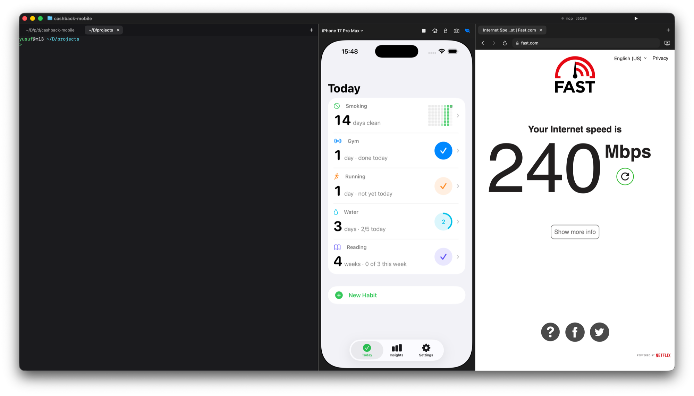

<p align="center">
  
</p>

<h1 align="center">Vibex</h1>

<p align="center">
  A native macOS workstation for building while watching:<br>
  <b>terminal · embedded iOS Simulator · side browser</b> in one window, driven by Claude Code over MCP.
</p>

<p align="center"><a href="https://uwussimo.github.io/vibex/">uwussimo.github.io/vibex</a></p>

- **Terminal**: real PTY terminals with tabs (SwiftTerm, Metal renderer), fish by default. Run Claude Code here.
- **Simulator**: the iOS Simulator rendered inside Vibex from CoreSimulator's framebuffer, with touch, keyboard and buttons. No Simulator.app window.
- **Browser**: a tabbed WebKit browser. Netflix plays here; your localhost previews open in their own tabs.
- **MCP**: a built-in server so Claude Code can see and drive the simulator and the browser.

<p align="center">
  
</p>

## Install

```sh
curl -fsSL https://uwussimo.github.io/vibex/install.sh | sh
```

The script downloads the latest release, checks its SHA-256, installs Vibex to `/Applications` (quitting a running
copy first) and opens it. Downloads made with `curl` are not quarantined, so macOS lets the un-notarized app open.
Set `VIBEX_VERSION=1.0.0` to pin a version or `VIBEX_INSTALL_DIR` to install elsewhere.

Or download **Vibex-1.0.0.dmg** from [Releases](https://github.com/uwussimo/vibex/releases/latest) and drag Vibex to
Applications. Vibex is not notarized yet, so macOS blocks a DMG downloaded in a browser: click **Done**, then
**System Settings → Privacy & Security → Open Anyway** (or `xattr -d com.apple.quarantine ~/Downloads/Vibex-*.dmg`).

Open a project from a terminal with `vibex .` (or `vibex <folder>…`), like VS Code's `code`. The installer links
the command into the first writable folder on your PATH; with the DMG, use **Vibex → Install 'vibex' Command**.

Vibex bundles [simslim](https://github.com/MobAI-App/simslim) and [XcodeGen](https://github.com/yonaskolb/XcodeGen);
copies you install yourself take precedence.

You also need, and Vibex cannot bundle:

- **Xcode 26** with an iOS simulator runtime (Vibex uses its simulator frameworks).
- **Claude Code** (`npm install -g @anthropic-ai/claude-code`) to drive Vibex over MCP.
- **fish** is optional (`brew install fish`); without it terminals use your login shell.

macOS 26 on Apple silicon or Intel (the app and its bundled tools are universal).

## Requirements

- macOS 26, Xcode 26 with at least one iOS simulator runtime
- [XcodeGen](https://github.com/yonaskolb/XcodeGen): `brew install xcodegen`

## Build and run

```sh
make run        # generates Vibex.xcodeproj, builds Debug, launches the app
make test       # unit tests (Swift Testing)
make open       # open the project in Xcode
make icon       # re-render the app icon from docs/icon.svg
make release    # Release build with bundled tools, signed, packed as build/release/Vibex-<version>.dmg
```

The first time Xcode opens the project it asks to trust SwiftTerm's build plugin. Command-line builds pass
`-skipPackagePluginValidation` for the same reason.

## Projects

Vibex works like VS Code: one window per project folder. **File → Open Folder… (⌘O)**, **Open Recent**, or drop
a folder on the Dock icon. Each window keeps its own terminal tabs (starting in the folder), browser tabs,
simulator and layout, saved in `~/Library/Application Support/Vibex/Projects`. Open windows come back on relaunch,
and a welcome window lists recent projects when none are open.

## Run

**Run (⇧⌘R)** or the ▶ in the title bar runs the project, with output in a Run terminal tab:

| Project | What Run does |
| --- | --- |
| iOS (Xcode or XcodeGen) | Builds for the window's simulator, boots it if needed, installs and launches the app |
| macOS (Xcode or XcodeGen) | Builds and opens the app |
| `package.json` with `dev`/`start` | Starts the dev server and opens it in a Preview browser tab once it answers |
| Swift package, Cargo, Go, `make run` | Runs the command |

Stop with ⌘. Detection can be overridden with a `.vibex.json` in the project root (Run → Edit Run Configuration
writes one):

```json
{ "run": { "kind": "web", "command": "pnpm dev", "url": "http://localhost:5173" } }
```

Kinds are `ios`, `macos`, `web` and `command`; Xcode kinds take `project`, `scheme` and an optional `prepare`
step such as `xcodegen generate`.

## Command palette

**⇧⌘P** searches every menu command (with its shortcut), open and recent projects, terminal and browser tabs,
and simulators. Type a URL to open it in a new tab, or start with `$` to run the rest in a new terminal tab.

## Slim simulators (simslim)

Vibex boots simulators through [simslim](https://github.com/MobAI-App/simslim) when it is installed. simslim
disables the background daemons a simulator does not need (Siri, Spotlight, iCloud sync, photo analysis…),
which cuts a simulator's memory roughly 4× and lets several run side by side. Install it with:

```sh
brew install mobai-app/tap/simslim
```

or use the leaf button in the simulator header, which runs that command in a terminal tab. The leaf shows the
selected device's state (filled = slim) and toggles it; the device picker shows the live memory footprint. Trade-offs:
Spotlight, push notifications, StoreKit and universal links stop working inside a slim simulator. Turn it off per
device with the leaf or globally with Simulator → Boot Slim.

## Signing

`project.yml` signs with a specific Apple Development certificate (by SHA-1 hash). That keeps the app's code
requirement stable, so the Accessibility grant survives rebuilds. Ad-hoc signing would invalidate it on every
build. If you change the certificate, run `tccutil reset Accessibility com.yusuf.vibex` and grant again.

## Permissions

None. Vibex talks to CoreSimulator directly, so it needs neither Accessibility nor Screen Recording.

## Using Vibex from Claude Code (MCP)

Vibex serves an MCP server on `http://127.0.0.1:5150/mcp` (next free port if 5150 is taken), guarded by a bearer
token, and registers itself with the Claude Code CLI at user scope on launch (`claude mcp get vibex` shows it).
Every Claude Code session, including the ones in Vibex's terminal (which also gets `VIBEX_MCP_URL` and
`VIBEX_MCP_TOKEN`), can then drive the workstation:

- **Simulator**: `simulator_list/boot/shutdown/info`, `simulator_screenshot`, `simulator_describe` (accessibility
  tree with refs), `simulator_find`, `simulator_tap_element`, `simulator_tap/long_press/swipe/type/press_key/button`,
  `simulator_install_app/launch_app/terminate_app/list_apps/open_url/logs`.
- **Browser**: `browser_tabs/new_tab/close_tab/select_tab/navigate/back/forward/reload`, `browser_snapshot`
  (page tree with refs), `browser_click/type/press/scroll/text/screenshot/evaluate/console/requests/wait`.
- **Workspace**: `vibex_layout`, `vibex_focus`, `vibex_notify`, `terminal_run`, `terminal_tabs`.

**Projects:** Claude Code running in a project's terminal drives *that* project's window. Vibex finds the
calling process among each window's terminal shells by the connection's source port; other callers act on
the most recently focused window. With several projects open, results start with `[project: name]`, and
`vibex_projects` / `vibex_open_project` list and open them. `vibex_run`, `vibex_stop` and `vibex_run_status` drive
Run.

The title bar shows `mcp :5150` with a green dot while a client is active. Vibex → "Copy MCP Config" puts the
`claude mcp add` command and JSON on the clipboard; "Re-register MCP with Claude Code" rotates the token.
`skills/vibex/SKILL.md` teaches an agent the workflow.

## Keyboard

| Shortcut | Action |
| --- | --- |
| ⇧⌘P | Command palette |
| ⌘O / ⌘N / ⇧⌘W | Open folder / home folder window / close window |
| ⇧⌘R / ⌘. | Run / stop the project |
| ⌘T / ⌘W | New / close tab in the focused pane |
| ⌘⇧[ / ⌘⇧] | Previous / next tab |
| ⌘K | Clear terminal |
| ⌘1 / ⌘2 / ⌘3 | Focus terminal / simulator / browser |
| ⌘⇧B | Build mode: wide terminal, simulator at natural size, Netflix mini player |
| ⌥⌘W | Watch mode: Netflix wide, simulator hidden |
| ⌘⇧0 | Back to your own divider positions |
| ⌘L / ⌘R / ⌘[ / ⌘] | Browser: open location, reload, back, forward |
| ⌘⇧N | Browser: go to Netflix |
| ⌘⇧H / ⌘⇧L | Simulator: Home / Lock |
| ⌘⇧S | Copy a screenshot of the booted simulator |

## How the embedded simulator works

Vibex does what Simulator.app and idb do, minus the window: it loads Xcode's private CoreSimulator and
SimulatorKit frameworks, finds the booted device's main display, and reads its framebuffer as an IOSurface.
That surface is drawn by a CALayer (zero-copy, GPU) and refreshed on the display's per-frame callback.
Clicks and drags become Indigo touch messages; keys become Indigo keyboard messages; Home and Lock are
hardware-button messages, all sent through `SimDeviceLegacyHIDClient`. Devices boot headlessly with
`simctl` (or `simslim on`), so Simulator.app never needs to run, and several devices can be booted and
switched between from the device picker.

This relies on private API that Apple changes between Xcodes. It is verified on Xcode 26.6 / CoreSimulator
1051. idb's notes say CoreSimulator 1155.4+ drops the legacy input path in favour of a `dtuhidd` transport;
when Xcode moves there, `SimulatorInput` needs that transport.

## Layout

```
Vibex/
  App/        AppDelegate, main entry, project windows, window manager, menu
  Projects/   project model, per-project state store, session, welcome window
  Run/        run configuration, detection, runner, title-bar button
  Palette/    command catalog, fuzzy matching, palette view
  Layout/     split view controller, layout modes, spring animator
  Terminal/   SwiftTerm tabs, theme, session
  Simulator/  simctl + simslim clients, header, pane; Embedded/ holds the CoreSimulator bridge,
              framebuffer, display view and HID input
  Browser/    WKWebView factory, toolbar, pane
  Support/    logging, defaults, accessibility permission, shared UI
VibexTests/   Swift Testing suites for layout math, spring, simctl parsing, URL handling
```
